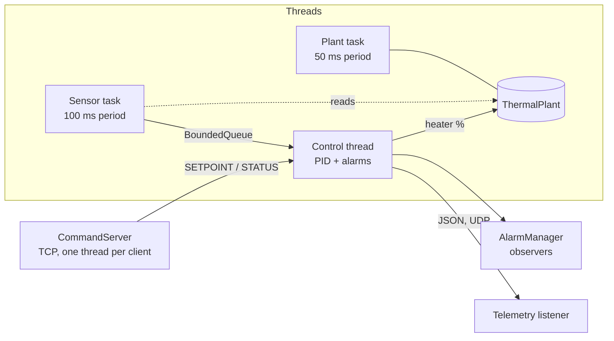

# thermoguard

A multi-threaded **industrial temperature control system** written in modern C++17.
A simulated heated process is measured by a noisy sensor, controlled by a PID loop
with a safety interlock, and exposed over **TCP** (commands) and **UDP** (telemetry).

It is a software model of the kind of loop found in industrial automation and
embedded equipment (heater + sensor + controller + alarms + network interface).


## Architecture



| Component | File | What it does |
| --- | --- | --- |
| `BoundedQueue<T>` | `include/plant/bounded_queue.hpp` | Thread-safe blocking queue (mutex + 2 condition variables), back-pressure, `close()` for clean shutdown |
| `PeriodicTask` | `src/scheduler.cpp` | Fixed-period task on its own thread, absolute deadlines, jitter measurement, optional `SCHED_FIFO` |
| `PidController` | `include/plant/pid.hpp` | Discrete PID, derivative on measurement, integral clamping (anti-windup) |
| `ThermalPlant` | `include/plant/thermal_plant.hpp` | First-order process model with an exact step (independent of step size) |
| `ISensor` + factory | `include/plant/sensor.hpp` | Sensor interface; simulated sensor adds Gaussian noise |
| `AlarmManager` | `include/plant/alarm.hpp` | High/low limits with hysteresis, observer notifications on transitions |
| `ControlSystem` | `src/control_system.cpp` | Wires sensor, queue, PID, alarms, plant; over-temperature interlock |
| `CommandServer` | `src/command_server.cpp` | Multi-client TCP server with a line protocol |
| `net::*` | `src/net.cpp` | RAII sockets, TCP and UDP helpers (POSIX, IPv4) |

## What it demonstrates

| Topic | Where |
| --- | --- |
| Modern C++ (C++17): templates, `std::optional`, `std::unique_ptr`/`shared_ptr`, lambdas, `std::chrono`, structured RAII | whole code base |
| Object-oriented design and patterns: interface (`ISensor`), **Observer** (`IAlarmListener`), **Factory** (`make_sensor`), **Adapter** (`CallbackAlarmListener`) | `sensor.hpp`, `alarm.hpp` |
| Multi-threading and synchronisation: `std::thread`, `std::mutex`, `std::condition_variable`, `std::atomic`, producer-consumer | `bounded_queue.hpp`, `control_system.cpp` |
| Memory management: RAII everywhere, no raw `new`/`delete`, move-only sockets, no detached threads | `net.hpp`, `command_server.cpp` |
| Embedded / industrial automation concepts: control loop, PID, sensor noise, alarm hysteresis, safety interlock, periodic tasks | `pid.hpp`, `alarm.hpp`, `control_system.cpp` |
| Real-time concepts: fixed-period scheduling, absolute deadlines, jitter measurement, `SCHED_FIFO` request | `scheduler.cpp` |
| Network protocols: **TCP** multi-client server with framing, **UDP** telemetry | `command_server.cpp`, `net.cpp` |
| Linux / POSIX: sockets, `poll`, `pthread_setschedparam`, signal handling | `net.cpp`, `plant_controller.cpp` |
| Data structures and algorithms: bounded queue (deque), PID, state machine with hysteresis | `bounded_queue.hpp`, `alarm.hpp` |
| Automated testing and CI/CD: 71 GoogleTest tests, GitHub Actions on GCC and Clang, ThreadSanitizer, AddressSanitizer, UBSan | `tests/`, `.github/workflows/ci.yml` |
| Tooling: CMake, Docker, Git | `CMakeLists.txt`, `Dockerfile` |

## Build and test

Requires a C++17 compiler (GCC or Clang) and CMake 3.14+ on Linux. GoogleTest is downloaded automatically.

```bash
cmake -S . -B build -DCMAKE_BUILD_TYPE=Release
cmake --build build -j
ctest --test-dir build --output-on-failure
```

Run under sanitizers:

```bash
cmake -S . -B build-tsan -DCMAKE_BUILD_TYPE=Debug -DSANITIZE=thread
cmake --build build-tsan -j && ctest --test-dir build-tsan --output-on-failure

cmake -S . -B build-asan -DCMAKE_BUILD_TYPE=Debug -DSANITIZE="address,undefined"
cmake --build build-asan -j && ctest --test-dir build-asan --output-on-failure
```

## Run it

```bash
./build/plant_controller --speed 20          # 20 simulated seconds per real second
```

In other terminals:

```bash
./build/plantctl send 127.0.0.1 5000 STATUS
./build/plantctl send 127.0.0.1 5000 SETPOINT 65
./build/plantctl listen 5001 5               # print 5 UDP telemetry packets
```

Or with `nc`:

```bash
printf 'STATUS\n' | nc -q1 127.0.0.1 5000
```

Options: `--host`, `--tcp-port`, `--udp-host`, `--udp-port`, `--speed`, `--setpoint`, `--duration`, `--realtime PRIORITY` (Linux, needs privileges).

### Docker

```bash
docker build -t thermoguard .
docker run --rm -p 5000:5000 thermoguard
```

## Protocol

TCP, one command per line, replies end with `\n`. Commands are case-insensitive.

| Command | Reply |
| --- | --- |
| `STATUS` | `OK temp=54.96 setpoint=50.00 heater=35.4 alarm=NORMAL samples=19 dropped=0` |
| `SETPOINT <celsius>` | `OK setpoint=65.00`, or `ERR ...` (valid range 10 to 90) |
| `HELP` | `OK commands: ...` |
| `QUIT` | `BYE`, then the server closes the connection |

UDP telemetry, one JSON line per sample sent to `--udp-host:--udp-port`:

```json
{"temp":55.933,"setpoint":50.00,"heater":39.8,"alarm":"NORMAL","samples":17}
```

## Design notes

- **Exact plant step.** `ThermalPlant::step` uses the closed-form solution for a constant heater, so simulation speed (`--speed`) never causes numerical error.
- **Back-pressure.** The sensor task uses `try_push`: if the controller falls behind, samples are dropped and counted (`dropped=`) instead of blocking the sensor.
- **Safety interlock.** Above the high alarm limit the controller forces the heater off and resets the PID, regardless of the setpoint.
- **Alarm hysteresis.** Prevents the alarm from chattering when the temperature hovers around a limit.
- **Clean shutdown.** Every thread is joined. Queues are closed to wake blocked consumers. Server loops poll with a timeout so `stop()` returns quickly.
- **Listeners run outside the lock,** so a listener may safely call back into the `AlarmManager`.

## Limitations and possible extensions

- `PeriodicTask` gives **soft** real-time behaviour on a general-purpose OS. It is not a hard real-time RTOS. A natural next step is porting the tasks and queue to FreeRTOS on a microcontroller.
- The TCP server uses one thread per client. For many clients, use `epoll` or Boost.Asio.
- IPv4 only; no authentication or TLS on the command port.
- Only the C++ standard library is used. Boost could replace parts (for example `boost::circular_buffer` for sensor history or Asio for networking).
- Possible additions: more sensors and actuators, logging to file, configuration file, auto-tuning.
